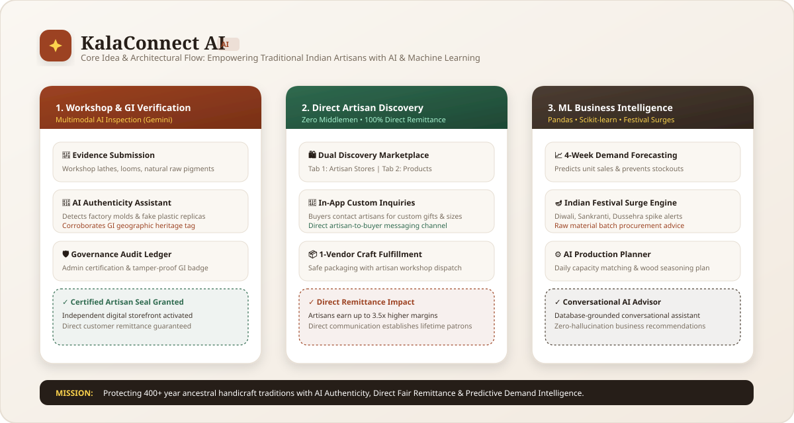
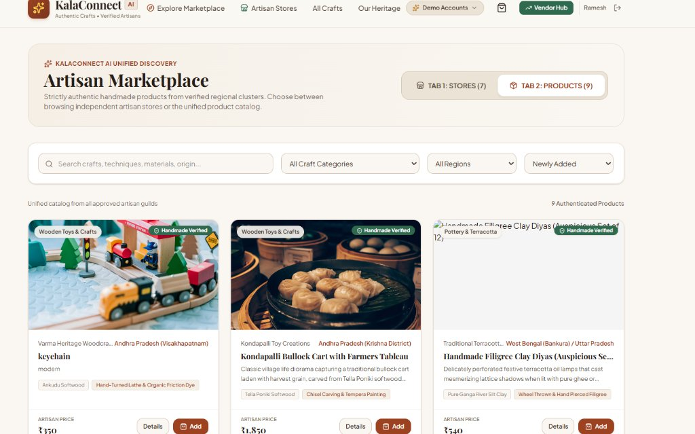
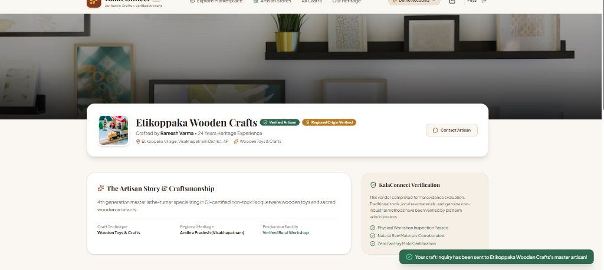
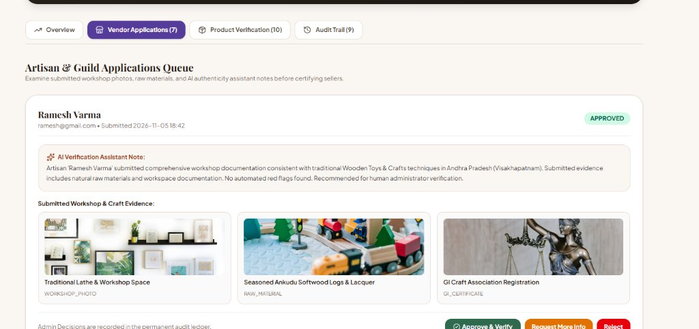

# KalaConnect AI
> **Authentic Crafts. Verified Artisans. Unique Discoveries.**

An AI-powered, multi-vendor marketplace built exclusively for genuine handmade, traditional, culturally significant, and region-specific products — featuring Indian handicrafts, GI-certified specialties, terracotta, Kalamkari hand-drawn textiles, lathe-turned lacquer toys, and bamboo crafts.

---

## 💡 The Idea: Reimagining the Indian Artisan Economy



### The Core Challenge
* **Middleman Exploitation**: Traditional rural Indian artisans frequently receive less than 15-20% of their creations' market value when selling through unorganized intermediary trade chains.
* **Proliferation of Factory Replicas**: Commercial tourist hubs are flooded with mass-manufactured plastic molds and synthetic factory prints disguised as handmade heritage crafts.
* **Unpredictable Festive Demand & Stockouts**: Artisans often lack historical data or ML forecasting to prepare raw materials (wood seasoning, handloom yarn, natural dyes) ahead of major cultural surges (Diwali, Makar Sankranti, Dussehra).

### The KalaConnect AI Solution
1. **Multimodal AI Authenticity Verification (Gemini Vision)**: Inspects workshop photos, lathe turning tools, loom setups, and natural raw materials to guarantee zero factory molds and authenticate Geographical Indication (GI) heritage.
2. **Direct-to-Artisan Digital Studios & In-App Inquiries**: Eliminates middlemen by providing verified master craftsmen with independent storefronts, direct payments, and real-time in-app customer inquiry replies.
3. **Machine Learning Demand & Seasonal Surge Engine (Pandas & Scikit-learn)**: Evaluates historical sales velocity and Indian festival calendars to generate 4-week production schedules and batch procurement recommendations.

---

## 📸 Platform Walkthrough & Visual Experience

### 1. Unified Discovery Marketplace (Stores & Products)
Buyers can discover verified master craftsmen by name, craft, or region, explore independent studios, or browse certified handmade creations with Geographical Indication (GI) tags:



---

### 2. Verified Artisan Storefronts & Direct Inquiries
Each master craftsman has a dedicated digital studio showcasing their ancestral lineage, verified workshop inspection criteria, and a direct inquiry channel for custom orders:



---

### 3. AI Authenticity & Evidence Verification Pipeline
Before a craftsman can sell, their workshop evidence (lathes, hand tools, natural dyes, GI certificates) is evaluated by our AI Authenticity Assistant and confirmed by platform administrators:



---

## 🚀 Quick Start: How to Run the Platform

You can run both the Backend and Frontend with a single click or in two terminal windows:

### Option A: One-Click Launch (Windows)
Double-click `start_all.bat` or run:
```bash
.\start_all.bat
```
This automatically launches the FastAPI Backend (Port 8000) and Next.js Frontend (Port 3000) in separate terminals.

---

### Option B: Manual Two-Terminal Launch

#### 1. Start the FastAPI Backend (Port 8000)
```bash
# In project root:
python -m uvicorn backend.app.main:app --host 127.0.0.1 --port 8000 --reload
```
- **API URL:** `http://127.0.0.1:8000`
- **Interactive Swagger Docs:** `http://127.0.0.1:8000/docs`
*(On startup, the SQLite database auto-seeds with verified artisan stores, products, historical sales, and festival calendars!)*

#### 2. Start the Next.js Frontend (Port 3000)
```bash
# In frontend directory:
cd frontend
npm run dev
```
- **Web Application:** `http://localhost:3000`

---

## 👥 Demo Accounts (1-Click Switcher Available in UI)

You can instantly switch between roles in the top navbar via the **"Demo Accounts"** dropdown:

| Role | Name & Details | Email | Password |
|---|---|---|---|
| **Administrator** | KalaConnect Admin (Application & Product Verification) | `admin@kalaconnect.ai` | `Admin@123` |
| **Artisan / Vendor 1** | Ramesh Varma (Etikoppaka GI Wooden Crafts) | `ramesh@etikoppaka.com` | `Artisan@123` |
| **Artisan / Vendor 2** | Lakshmi Devi (Kalamkari Heritage Studio) | `lakshmi@kalamkari.com` | `Artisan@123` |
| **Artisan / Vendor 3** | Suresh Achary (Kondapalli Softwood Toys) | `suresh@kondapalli.com` | `Artisan@123` |
| **Customer / Collector** | Priya Sharma (Bengaluru Buyer) | `priya@customer.com` | `Customer@123` |

---

## 🌟 Key Modules & Architecture

### 1. Customer Marketplace & Artisan Discovery
- **Two Primary Separated Tabs:**
  - **Tab 1: STORES:** Independent vendor storefront cards with artisan profile, location, GI origin badge, and product count.
  - **Tab 2: PRODUCTS:** Unified product catalog from all approved artisan guilds with category, region, and price filters.
- **Direct Artisan Searchbar (for Buyers):** Search master craftsmen by name, craft, or location with quick-actions to contact or visit.
- **Cart & Direct Orders:** 1-vendor shipment grouping rule, custom production lead times, and live status progression.

### 2. Artisan Studio Hub (`/vendor/dashboard`)
- **No Buyer Search Options:** Focused strictly on selling handmade creations, tracking sales, and managing production.
- **In-App Direct Replies:** Artisans can reply directly to customer requests with quick response presets, which immediately notifies the buyer.
- **Workshop Order Management:** Live progression toolbar (`Accepted` &rarr; `In Production` &rarr; `Ready for Dispatch` &rarr; `Shipped`).

### 3. AI Demand Forecasting Engine
- **Powered by Pandas & Scikit-learn:** Time-aware evaluation incorporating historical sales velocity and festival demand surges.
- Identifies high/low demand items, projected units, safety stock, and stockout risk alerts.

### 4. Seasonal Intelligence Engine
- Indian festival calendar (Diwali, Makar Sankranti, Ugadi, Dussehra, Pongal, Crafts Fairs).
- Correlates artisan craft categories with upcoming occasions, procurement lead times, and batch size advice.

### 5. AI Business Advisor (Conversational Assistant)
- Chat interface in Vendor Dashboard backed by real database tools (`get_sales_summary`, `get_inventory`, `get_product_performance`, `get_demand_forecast`).
- Strict zero-hallucination constraint: only cites authentic figures from the vendor's database.

---

## 🛠️ Technology Stack
- **Frontend:** Next.js (App Router), React, TypeScript, Tailwind CSS, Lucide Icons.
- **Backend:** Python FastAPI, Pydantic, SQLAlchemy, JWT Authentication.
- **AI & Analytics:** Gemini API (Vision & Multimodal Product Assistant), Pandas, Scikit-learn.
- **Database:** SQLite local (auto-migrated & pre-seeded) / PostgreSQL compatible.
